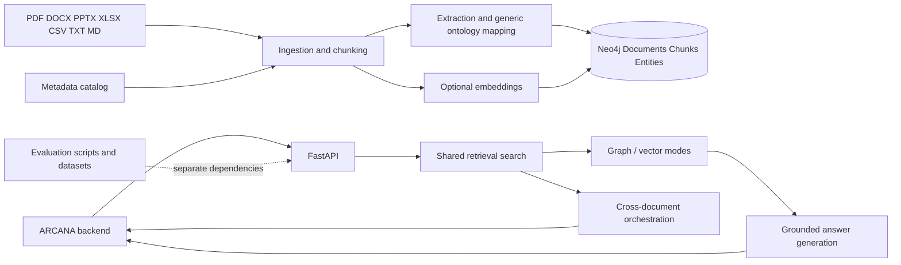

# System architecture (implemented)

Runtime is in `kb`, `kb_api`, `ui`, `schema`, and deployment files. Evaluation scripts and retained results live in `evaluation`, `scripts`, and `reports`. Docker runtime installs `requirements-runtime.txt`; development/evaluation installs `requirements-evaluation.txt`.
